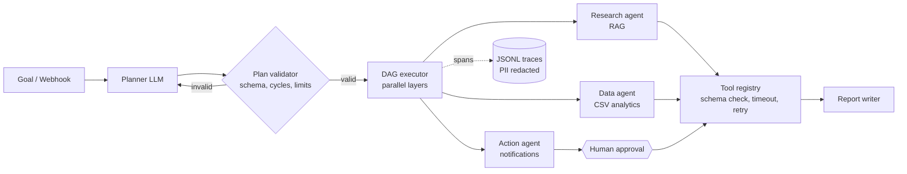

# AgentRelay

[](https://github.com/Deepak94799/agentrelay/actions)
 

A small, fully tested **multi-agent orchestration framework**. A planner turns a goal into a validated DAG of steps, specialist agents execute them in parallel with least-privilege tools, risky actions wait for human approval, and every run is traced and scored by an evaluation harness that gates CI.

It is built around the problems that break real agent systems: invalid model plans, flaky tools, unsafe side effects, silent regressions and untraceable failures.



## Features

| Area | What it does |
|---|---|
| **Plan validation** | Rejects unknown agents, missing dependencies, cycles and oversized plans. One self-repair retry feeds the error back to the planner. |
| **Parallel DAG execution** | Independent steps run concurrently. A failed step skips only its dependents, so a run ends `completed`, `partial` or `failed` instead of crashing. |
| **Safe tool layer** | JSON-schema argument validation, per-tool timeouts, exponential-backoff retries for transient errors, and a path-traversal-proof CSV sandbox. |
| **Human-in-the-loop** | Side-effecting tools need approval (console prompt, auto-approve flag, or deny-all). Denied actions never execute and the run degrades gracefully. |
| **Least privilege** | Each agent has a tool allowlist, so a model cannot make the research agent send email. Notification recipients are domain-allowlisted. |
| **Retrieval (RAG)** | Dependency-free TF-IDF retriever with section-aware chunking. |
| **Observability** | Nested spans (run → agent → tool → LLM) written to JSONL, with e-mail addresses redacted. |
| **Evals** | Labelled cases score routing, tool-call accuracy, outcome and latency. `agentrelay eval` exits non-zero below a threshold, and CI uses it as a gate. |
| **Integrations** | FastAPI service with `POST /runs` and an HMAC-SHA256-signed `POST /webhooks/{source}` (constant-time comparison). Side effects are denied by default over HTTP. |
| **Pluggable LLM** | Deterministic offline model for reproducible tests and CI, or Anthropic via one adapter class. |

## Quickstart

```bash
git clone https://github.com/Deepak94799/agentrelay.git && cd agentrelay
pip install -e ".[dev]"

pytest -q                       # 22 tests
agentrelay eval                 # score the system on 9 labelled cases

agentrelay run "What is our refund policy for annual plans?"
agentrelay run "Summarize sales by region and email the result to lead@example.com" --yes
```

```text
[data] revenue by region (sum): East=247,880.0, North=204,640.0, West=202,280.0, South=157,840.0
[action] Notification 04fe336692 sent to lead@example.com.
status=completed  steps=2
```

Without `--yes` the CLI asks before any side effect. Run the API with `agentrelay serve`, or use Docker:

```bash
docker build -t agentrelay . && docker run -p 8000:8000 -e AGENTRELAY_WEBHOOK_SECRET=change-me agentrelay
```

```bash
body='{"goal":"What is our refund policy?"}'
sig="sha256=$(printf '%s' "$body" | openssl dgst -sha256 -hmac change-me | sed 's/^.* //')"
curl -s localhost:8000/webhooks/github -H "X-Signature: $sig" -d "$body"
```

### Use a real model

```bash
pip install -e ".[anthropic]"
export ANTHROPIC_API_KEY=...  AGENTRELAY_LLM=anthropic
agentrelay run "What is our refund policy?"
```

The adapter (`AnthropicLLM`) implements the same four-role contract (`plan`, `act`, `summarize`, `write`) as the offline model. The test suite and eval gate run on the offline model so they stay deterministic and free. Live-model quality is not part of the CI gate.

## Evaluation

`agentrelay eval` replays [`evals/cases.jsonl`](evals/cases.jsonl): knowledge lookups, analytics, multi-agent goals, approved and denied actions, and a guardrail case that tries to e-mail an external domain.

```text
cases=9  task_success=100%  routing=100%  tools=100%  p50≈3ms
```

These numbers are measured on the offline model, so they verify the *orchestration*: validation, routing, hand-off, approval and guardrails. They are not a claim about LLM answer quality.

## Project layout

```
src/agentrelay/
  orchestrator.py   plan validation, DAG executor, failure isolation
  agents.py         agents, allowlists, {{step}} hand-off templating
  tools.py          registry: schema validation, approval, timeout, retry
  builtin_tools.py  search_kb, query_csv (sandboxed), send_notification
  rag.py            TF-IDF retriever
  tracing.py        spans -> JSONL, PII redaction
  llm.py            LLM protocol, offline model, Anthropic adapter
  evals.py          metrics and report
  server.py         FastAPI + signed webhooks
tests/              22 tests: retries, timeouts, approvals, cycles, parallelism, signatures, evals
evals/cases.jsonl   labelled scenarios
```

## Design decisions

- **Validate the plan, don't trust it.** The planner's output is untrusted input, so the executor only sees a checked DAG.
- **Fail partially, not totally.** One denied or failing step should not discard the work of the others.
- **Approval lives in the tool layer.** An agent cannot bypass it, whatever the model says.
- **Evals are a build gate.** Behaviour changes show up in CI the way a failing unit test does.

## Limitations and next steps

- The retriever is lexical TF-IDF. Swap in embeddings and a vector store behind the same `search` interface for semantic recall.
- `send_notification` writes to a local outbox. Replace it with SMTP, Slack or a webhook for production.
- A timed-out tool thread cannot be killed in-process, so run untrusted tools in a subprocess or container.
- Run state is held in memory. Persist runs to a database for multi-instance deployment.

## License

MIT
